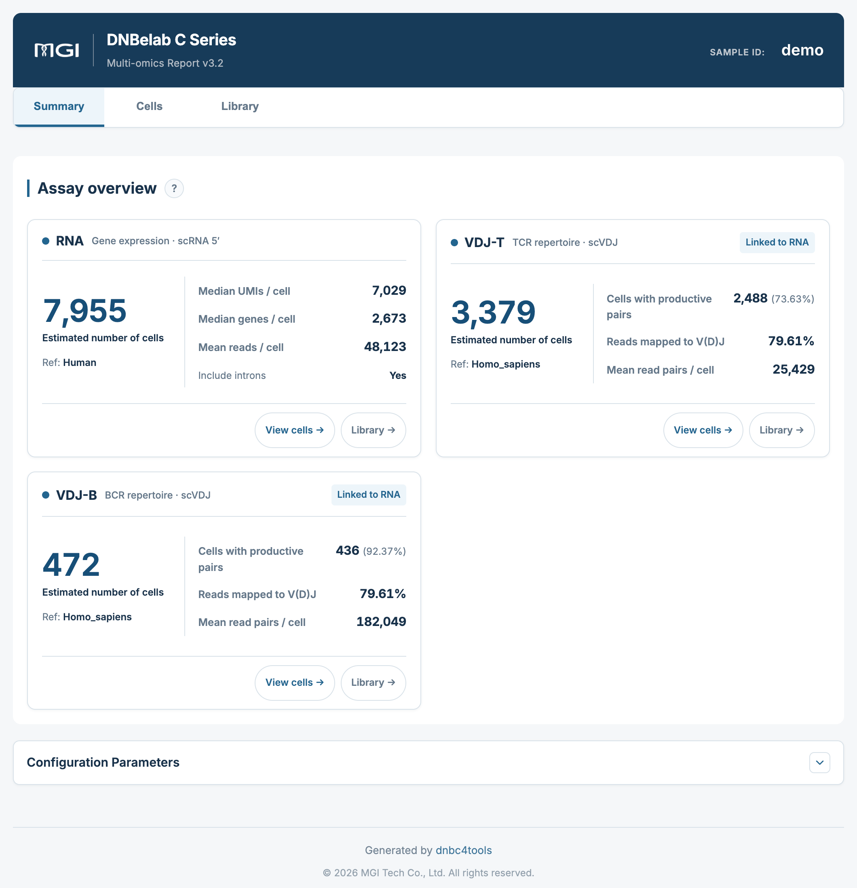
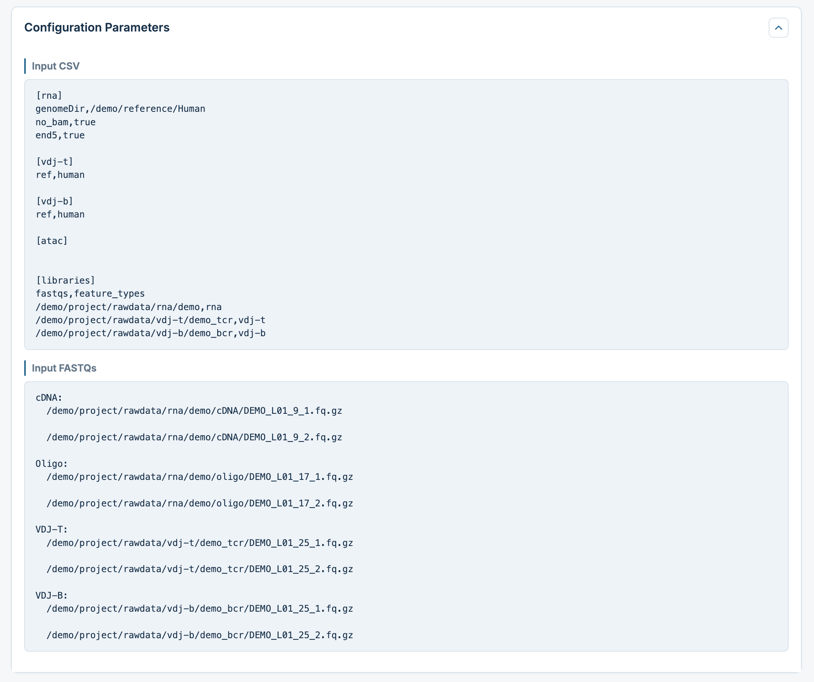
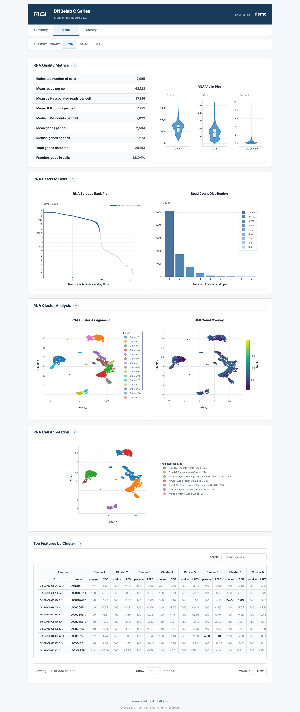
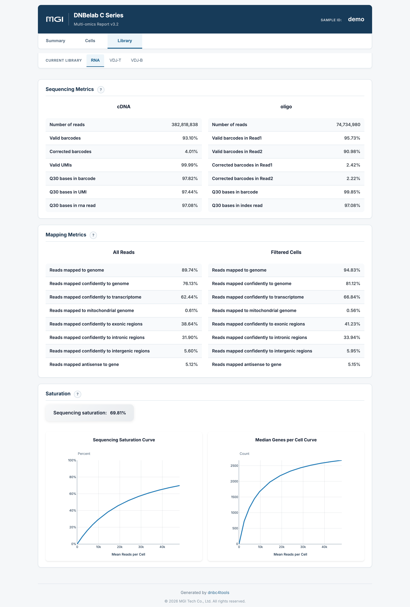
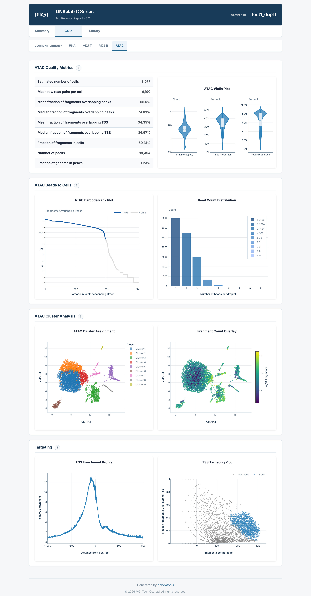
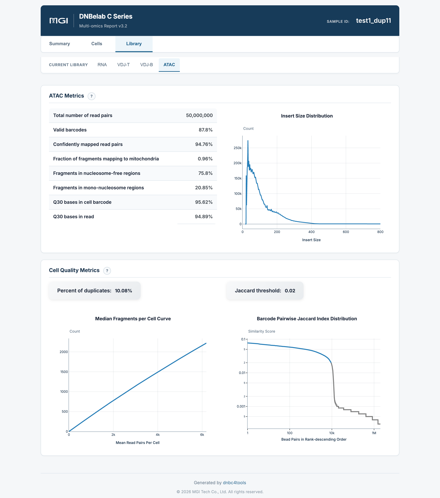
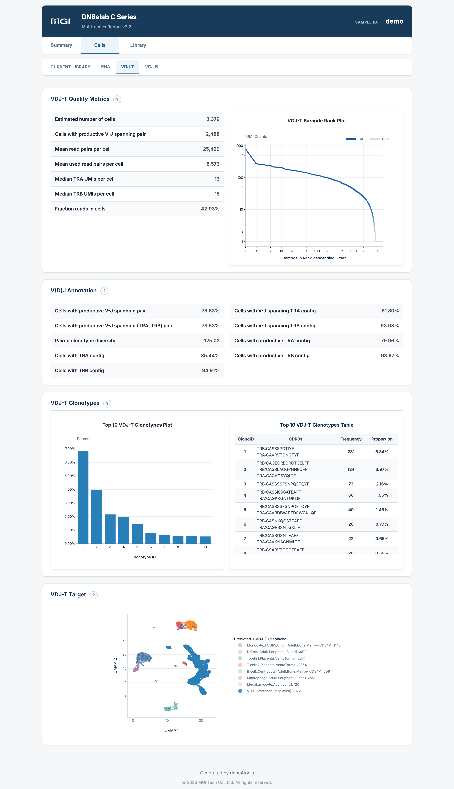
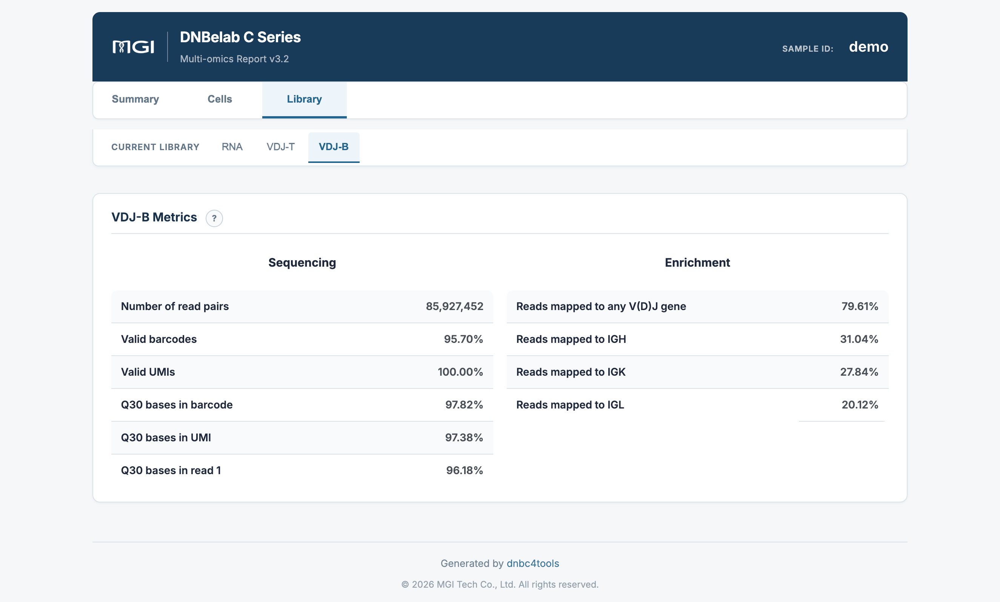

# 多组学分析输出

多组学整合分析输出文件说明

## 概述 <a id="概述"></a>

多组学流程会将 RNA / ATAC / VDJ 的关键结果统一整理到一个样本目录，支持在同一份报告中完成跨组学浏览和对比。

> **提示**
>
> 组合报告用于快速总览和跨模块查看。需要详细说明时，请进入对应单组学 outs 文档。

## 输出目录结构 <a id="输出目录结构"></a>

```text
<outdir>/<sample>/
└── outs/
    ├── <sample>_multi_report.html             # 多组学组合报告
    ├── rna/                                   # RNA 结果目录（若启用）
    ├── atac/                                  # ATAC 结果目录（若启用）
    ├── vdj-t/                                 # VDJ-T 结果目录（若启用）
    └── vdj-b/                                 # VDJ-B 结果目录（若启用）
```

## 详细文件说明 <a id="详细文件说明"></a>

### `outs/<sample>_multi_report.html`

- **内容**：整合展示 RNA / ATAC / VDJ 的核心 QC 与分析图表。
- **用途**：一页内完成跨组学质量检查与结果浏览。

### `outs/rna`, `outs/atac`, `outs/vdj-t`, `outs/vdj-b`

- **内容**：对应模块的标准输出（矩阵、统计表、模块报告等）。
- **用途**：用于下游模块化分析或单组学复用。

## C6 多样本 RNA 输出 <a id="c6-outputs"></a>

含 `[samples]` 的运行采用以下布局。普通单样本 Multi 使用上方的模态目录。

```text
<run>/outs/
├── <run>_multi_report.html
└── rna/
    ├── raw_feature_bc_matrix/             # 含背景的全局矩阵
    ├── raw_feature_bc_matrix.h5
    ├── filtered_feature_bc_matrix/        # 全部 called cells
    ├── filtered_feature_bc_matrix.h5
    ├── filtered_feature_bc_matrix.h5ad    # 稀疏计数，无联合聚类
    ├── singlecell.csv.gz                 # 完整六列表，含背景
    ├── metrics_summary.xls               # 制表符分隔文本
    ├── oligo.records.bam                 # 启用 BAM 时
    ├── unassigned_alignments.bam         # 启用 BAM 时
    ├── multi_sample/
    │   ├── per_sample_metrics.csv
    │   ├── sample_metrics_summary.xls
    │   ├── barcode_assignment_metrics.json
    │   └── high_occupancy_metrics.json
    └── per_sample_outs/<sample>/
        ├── raw_feature_bc_matrix/
        ├── raw_feature_bc_matrix.h5
        ├── filtered_feature_bc_matrix/
        ├── filtered_feature_bc_matrix.h5
        ├── filtered_feature_bc_matrix.h5ad
        ├── <sample>_scRNA_report.html
        ├── metrics_summary.xls
        ├── <sample>_alignments.bam         # 启用 BAM 时
        └── analysis/                     # 样本级聚类、marker 等
```

BAM 随实际基因组范围附带 `.bai` 或 `.csi`；`no_bam=true` 不交付样本 BAM、Unassigned BAM 或 oligo BAM。双物种时可额外交付全局 `analysis/cell_classification.csv`；单物种不创建空的全局 analysis 目录。子样本分析文件按实际成功状态交付，空或失败样本不交付残留的旧分析结果。

全局不交付联合 cluster/marker、`QC_Cluster.h5ad` 或运行级 RNA HTML。全局 H5AD 只提供合并计数；每个样本有自己的分析与完整 RNA 报告。处理目录 `SAMPLE_SPLIT`、`MULTI_CELL_CALLING`、`tempN` 及报告缓存不属于公共交付结构。

### `singlecell.csv.gz`

| 列 | 含义 |
| :--- | :--- |
| `cell` | 合并后 cell 标识；异常缺失映射背景可为空 |
| `reads` | 对应分组汇总的 reads 计数 |
| `gene` / `umi` | 该分组的检测基因与 UMI 数 |
| `is_cell_barcode` | 有效细胞标记 |
| `barcode` | 原始 barcode 成员信息，保留 probe 后缀 |

完整表保留背景及零 UMI 行；正 UMI 行降序，零 UMI 行在末尾保持原组序。无需先手工解压，读取方式见[结果读取](../io.md#c6-import)。

### 报告与指标分母

| 内容 | 使用范围和解释 |
| :--- | :--- |
| 根目录 Multi 报告 | 批次概览、Library QC 与 Samples 比较；C6 chemistry 显示 `scRNAC6` |
| 逐样本 RNA 报告 | 该样本的细胞、聚类、marker、比对和饱和度结果；缺失值显示 N/A |
| Assigned Reads | 已分配到该样本的 read pairs，不是全库原始 reads |
| Mean Reads per Cell | Assigned Reads / Cells；细胞数为 0 或缺失时不计算 |
| Fraction reads in cells | 该样本细胞内可信转录组 reads / 该样本全部有效 barcode 的可信转录组 reads |
| 样本 Mapping Quality | 使用该样本 All Reads 范围；不能混入 Filtered Cells 的比例 |
| 逐样本 cDNA Valid barcodes | Assigned Reads > 0 时为 100%，只描述已分配集合；为零或缺失时 N/A |
| Q30 / Valid UMI / Corrected barcodes / Oligo QC | 来自全库共享测量，不能解释为样本独立 QC；指标表保留 `cDNA QC scope` |
| cell/probe barcode 有效率 | 分别来自纠错阶段的真实统计，不从联合有效率推算；缺失时 N/A |

`.xls` 汇总是制表符分隔文本。`sample_metrics_summary.xls` 每个配置样本一行，保留空/失败样本；All Reads 与 Filtered Cells 两组比对比例分别使用各自分母。旧 HTML 不会自动更新，模板修复后需要重生成报告。

## 网页报告释义 <a id="网页报告释义"></a>

**概述**：多组学组合报告整合展示 RNA / ATAC / VDJ 的核心 QC 与分析图表。

### Summary 与导航



`Summary` 页面定义了报告的两级导航：

- **上方组学栏（一级选项卡）**：`RNA`、`ATAC`、`VDJ-T`、`VDJ-B`。
- **左侧功能栏（二级选项卡）**：`Summary`、`Cells`、`Library`。

左侧功能栏说明：

- `Summary`：当前组学的核心概览指标与运行参数。
- `Cells`：细胞层面的质控、聚类、注释或克隆型信息。
- `Library`：文库与测序层面的质量指标（Q30、mapping、enrichment 等）。

### 参数信息



该区域用于展示本次运行的关键参数与输入 FASTQ 路径，建议在结果复现和问题排查时优先查看。

页面内容包括：

- 组学分段参数：`[rna]`、`[atac]`、`[vdj-t]`、`[vdj-b]` 的核心运行参数块。
- 输入数据配置：`[libraries]` 中 `fastqs` 与 `feature_types` 的对应关系。
- 输入文件路径：`Input FASTQs` 区域展示各文库实际使用的 FASTQ 路径。
- 视图切换：可按组学标签查看不同模块的参数片段。

### RNA 页面

#### `RNA > Cells`



页面内容包括：

- `RNA Quality Metrics`：细胞层面的质量统计与分布。
- `RNA Beads to Cells`：barcode rank 曲线与 beads/cell 分布。
- `RNA Cluster Analysis`：聚类结果和 UMAP 可视化。
- `RNA Cell Annotation`：细胞类型注释结果。
- `Top Features by Cluster`：各聚类的特征基因表。

#### `RNA > Library`



页面内容包括：

- `Sequencing Metrics`：reads、valid barcode、valid UMI、Q30 等测序基础指标。
- `Mapping Metrics`：all reads 与 filtered cells 的比对构成统计。
- `Saturation`：测序饱和度曲线与基因发现曲线。

参考：

- [scRNA 输出文档](./scRNA.md)

### ATAC 页面

#### `ATAC > Cells`



页面内容包括：

- `ATAC Quality Metrics`：细胞层面片段统计与 TSS 相关指标。
- `ATAC Beads to Cells`：barcode rank 曲线与 beads/cell 分布。
- `ATAC Cluster Analysis`：ATAC 聚类结果与降维可视化。
- `Targeting`：TSS enrichment profile 与 targeting 相关图表。

#### `ATAC > Library`



页面内容包括：

- `ATAC Metrics`：read pairs、valid barcode、mapping、mitochondrial ratio 等文库层指标。
- `Cell Quality Metrics`：重复率、Jaccard threshold 及相关曲线。

参考：

- [scATAC 输出文档](./scATAC.md)

### VDJ 页面

#### `VDJ-T / VDJ-B > Cells`



页面内容包括：

- `VDJ Quality Metrics`：生产性配对、UMI/read 支持度等细胞层指标。
- `V(D)J Annotation`：链别与配对注释统计。
- `VDJ Clonotypes`：克隆型丰度图与 Top clonotype 表。
- `VDJ Target`：V(D)J 细胞在降维图中的分布。

#### `VDJ-T / VDJ-B > Library`



页面内容包括：

- `Sequencing`：reads、valid barcode、valid UMI、Q30 等测序质量统计。
- `Enrichment`：映射到 V(D)J 基因及各链别（TRA/TRB 或 IGH/IGK/IGL）的比例。

参考：

- [scVDJ 输出文档](./scVDJ.md)

## 相关文档

| 文档 | 说明 |
| :--- | :--- |
| [多组学流程](../pipeline/multi.md) | 多组学分析流程详细说明 |
| [多组学参数](../parameter/multi.md) | 命令参数参考文档 |
| [scRNA 输出](./scRNA.md) | scRNA 模块输出文件说明 |
| [scATAC 输出](./scATAC.md) | scATAC 模块输出文件说明 |
| [scVDJ 输出](./scVDJ.md) | scVDJ 模块输出文件说明 |
| [输出文件](./outs.md) | 返回总输出文档索引 |
