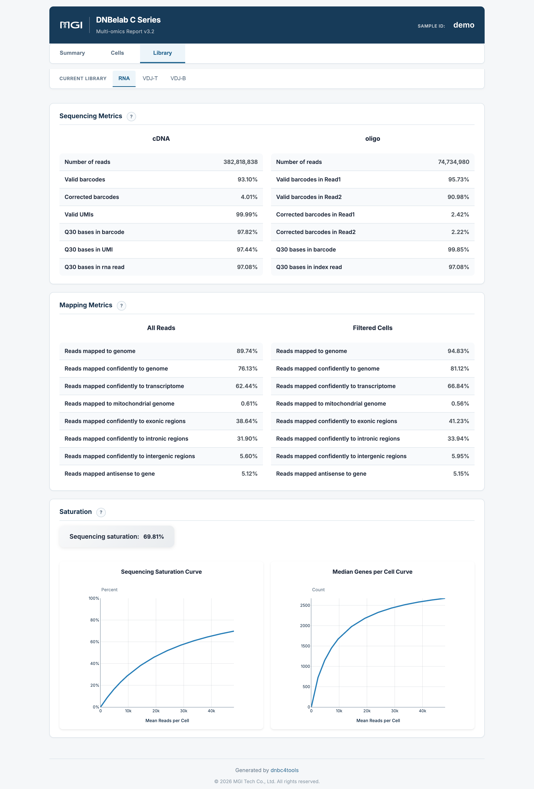
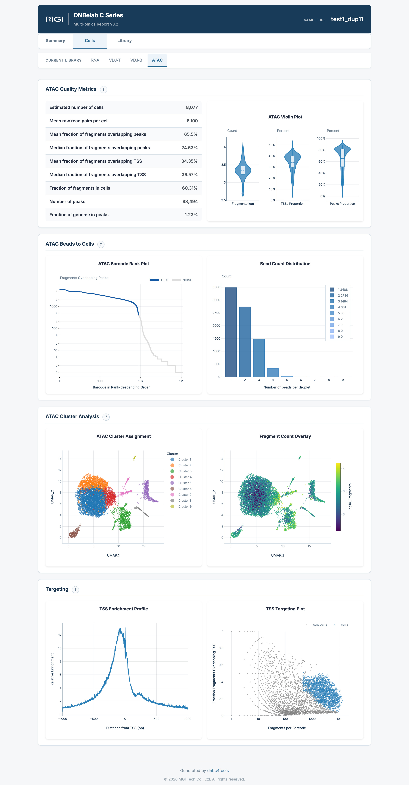

# Multi-omics Analysis Output

Integrated Multi-omics Output File Guide

## Overview <a id="overview"></a>

The multi-omics workflow organizes key RNA / ATAC / VDJ results into one sample-level directory, enabling cross-omics browsing and comparison within a single report.

> **Tip**
>
> The combined report is intended for fast overview and cross-module inspection. For detailed interpretation, please refer to each single-omics output document.

## Output Directory Structure <a id="output-directory-structure"></a>

```text
<outdir>/<sample>/
└── outs/
    ├── <sample>_multi_report.html             # Combined multi-omics report
    ├── rna/                                   # RNA outputs (if enabled)
    ├── atac/                                  # ATAC outputs (if enabled)
    ├── vdj-t/                                 # VDJ-T outputs (if enabled)
    └── vdj-b/                                 # VDJ-B outputs (if enabled)
```

## Detailed File Description <a id="detailed-file-description"></a>

### `outs/<sample>_multi_report.html`

- **Content**: Integrated QC and analysis charts across RNA / ATAC / VDJ.
- **Purpose**: Cross-omics quality check and result overview on one page.

### `outs/rna`, `outs/atac`, `outs/vdj-t`, `outs/vdj-b`

- **Content**: Standard module outputs (matrices, metrics tables, module reports, etc.).
- **Purpose**: Module-specific downstream analysis or single-omics reuse.

## C6 multiplexed RNA outputs <a id="c6-outputs"></a>

Runs with `[samples]` use this layout. Ordinary single-sample Multi uses the modality directories above.

```text
<run>/outs/
├── <run>_multi_report.html
└── rna/
    ├── raw_feature_bc_matrix/             # Global, including background
    ├── raw_feature_bc_matrix.h5
    ├── filtered_feature_bc_matrix/        # All called cells
    ├── filtered_feature_bc_matrix.h5
    ├── filtered_feature_bc_matrix.h5ad    # Counts, no joint clustering
    ├── singlecell.csv.gz                 # Complete six-column table
    ├── metrics_summary.xls               # Tab-separated text
    ├── oligo.records.bam                 # When BAM enabled
    ├── unassigned_alignments.bam         # When BAM enabled
    ├── multi_sample/
    │   ├── per_sample_metrics.csv
    │   ├── sample_metrics_summary.xls
    │   ├── barcode_assignment_metrics.json
    │   └── high_occupancy_metrics.json
    └── per_sample_outs/<sample>/
        ├── raw_feature_bc_matrix/
        ├── raw_feature_bc_matrix.h5
        ├── filtered_feature_bc_matrix/
        ├── filtered_feature_bc_matrix.h5
        ├── filtered_feature_bc_matrix.h5ad
        ├── <sample>_scRNA_report.html
        ├── metrics_summary.xls
        ├── <sample>_alignments.bam         # When BAM enabled
        └── analysis/                     # Sample clustering, markers, etc.
```

BAMs have `.bai` or `.csi` indexes as appropriate. `no_bam=true` omits sample, Unassigned and oligo BAMs. Mixed-species runs may add global `analysis/cell_classification.csv`; single-species runs do not publish an empty global analysis directory. Sample analysis outputs depend on successful completion; empty/failed samples do not publish stale analysis results.

There is no global joint cluster/marker result, `QC_Cluster.h5ad` or run-level RNA HTML. Global H5AD contains combined counts; individual samples retain their own analysis and full RNA report. Processing directories such as `SAMPLE_SPLIT`, `MULTI_CELL_CALLING`, `tempN` and report caches are internal.

### `singlecell.csv.gz`

| Column | Meaning |
| :--- | :--- |
| `cell` | Merged cell identifier; unmapped background can have a missing identifier |
| `reads` | Aggregated read count for the group |
| `gene` / `umi` | Detected genes and UMIs for the group |
| `is_cell_barcode` | Called-cell flag |
| `barcode` | Original barcode members, including probe suffixes |

The complete table retains background and zero-UMI rows. Positive-UMI rows descend by UMI; zero-UMI rows follow in group order. Read gzip directly; see [Result import](../io.md#c6-import).

### Reports and metric denominators

| Content | Scope and interpretation |
| :--- | :--- |
| Root Multi report | Batch overview, library QC and Samples comparisons; C6 chemistry is `scRNAC6` |
| Individual RNA report | Sample cells, clustering, markers, mapping and saturation; missing metrics show N/A |
| Assigned Reads | Read pairs assigned to that sample, not raw library reads |
| Mean Reads per Cell | Assigned Reads / Cells; undefined when cells are zero or missing |
| Fraction reads in cells | Sample confident-transcriptome reads in cells / confident-transcriptome reads across all valid sample barcodes |
| Sample Mapping Quality | Sample All Reads scope, not Filtered Cells ratios |
| Per-sample cDNA Valid barcodes | 100% if Assigned Reads > 0, describing only the assigned set; otherwise N/A |
| Q30 / Valid UMI / Corrected barcodes / Oligo QC | Shared library measurements, not independent sample QC; metric exports retain `cDNA QC scope` |
| Cell/probe barcode validity | Independent correction-stage measurements, not derived from joint validity; N/A if missing |

`.xls` files are tab-separated text. `sample_metrics_summary.xls` keeps one row per configured sample, including empty/failed samples. All Reads and Filtered Cells mapping groups each use their own denominators. Existing HTML must be regenerated to adopt template fixes.

## Web Report Interpretation <a id="web-report-interpretation"></a>

**Overview**: The combined multi-omics report provides integrated views of core QC and analysis charts from RNA / ATAC / VDJ modules.

### Summary and Navigation


The `Summary` page defines two-level navigation:

- **Top omics tabs (level 1)**: `RNA`, `ATAC`, `VDJ-T`, `VDJ-B`.
- **Left functional tabs (level 2)**: `Summary`, `Cells`, `Library`.

Left-tab roles:

- `Summary`: Core overview metrics and run parameters for the current module.
- `Cells`: Cell-level QC, clustering, annotation, and clonotype views.
- `Library`: Library/sequencing-level quality metrics (Q30, mapping, enrichment).

### Configuration Parameters


This section is recommended for reproducibility checks and troubleshooting.

Page content includes:

- Module parameter blocks: `[rna]`, `[atac]`, `[vdj-t]`, `[vdj-b]`.
- Input data mapping: `fastqs` and `feature_types` relations in `[libraries]`.
- Input file paths: actual FASTQ paths in the `Input FASTQs` section.
- View switching: inspect parameter blocks by omics tabs.

### RNA Pages

#### `RNA > Cells`


Page content includes:

- `RNA Quality Metrics`: Cell-level quality statistics and distributions.
- `RNA Beads to Cells`: Barcode-rank curve and beads-per-cell distribution.
- `RNA Cluster Analysis`: Clustering results and UMAP visualization.
- `RNA Cell Annotation`: Cell-type annotation results.
- `Top Features by Cluster`: Feature-gene table by cluster.

#### `RNA > Library`



Page content includes:

- `Sequencing Metrics`: Reads, valid barcodes, valid UMIs, Q30, etc.
- `Mapping Metrics`: Alignment composition for all reads and filtered cells.
- `Saturation`: Sequencing saturation and gene discovery curves.

Reference:

- [scRNA output documentation](scRNA.en.md)

### ATAC Pages

#### `ATAC > Cells`



Page content includes:

- `ATAC Quality Metrics`: Cell-level fragment and TSS-related metrics.
- `ATAC Beads to Cells`: Barcode-rank curve and beads-per-cell distribution.
- `ATAC Cluster Analysis`: ATAC clustering and low-dimensional visualization.
- `Targeting`: TSS enrichment profile and targeting-related charts.

#### `ATAC > Library`


Page content includes:

- `ATAC Metrics`: Read pairs, valid barcodes, mapping, mitochondrial ratio, etc.
- `Cell Quality Metrics`: Duplication rate, Jaccard threshold, and related curves.

Reference:

- [scATAC output documentation](scATAC.en.md)

### VDJ Pages

#### `VDJ-T / VDJ-B > Cells`


Page content includes:

- `VDJ Quality Metrics`: Productive pairing and UMI/read support metrics.
- `V(D)J Annotation`: Chain and pairing annotation statistics.
- `VDJ Clonotypes`: Clonotype abundance plot and top-clonotype table.
- `VDJ Target`: Distribution of V(D)J cells in low-dimensional embedding.

#### `VDJ-T / VDJ-B > Library`


Page content includes:

- `Sequencing`: Reads, valid barcodes, valid UMIs, Q30, etc.
- `Enrichment`: Mapping proportions to V(D)J genes and chain types (TRA/TRB or IGH/IGK/IGL).

Reference:

- [scVDJ output documentation](scVDJ.en.md)

## Related Documentation

| Document | Description |
| :--- | :--- |
| [Multi Pipeline](../pipeline/multi.en.md) | Detailed multi-omics analysis workflow |
| [Multi Parameters](../parameter/multi.en.md) | Command parameter reference |
| [scRNA Outputs](scRNA.en.md) | scRNA module output documentation |
| [scATAC Outputs](scATAC.en.md) | scATAC module output documentation |
| [scVDJ Outputs](scVDJ.en.md) | scVDJ module output documentation |
| [Output Files](./outs.en.md) | Return to output documentation index |
