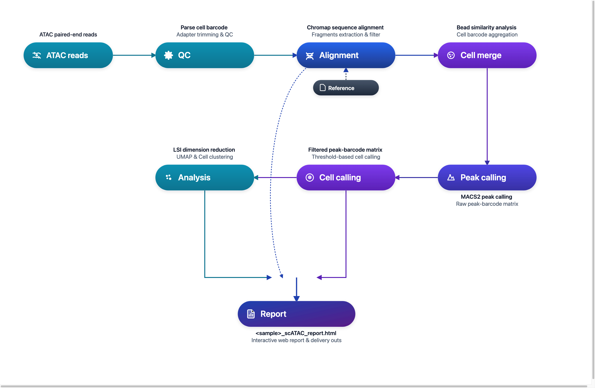

# DNBelab C Series HT scATAC Analysis Pipeline

Single-Cell ATAC Sequencing Data Analysis Guide

## Overview <a id="overview"></a>

This document provides a detailed guide for analyzing single-cell ATAC sequencing data using dnbc4tools.

**Workflow**: Raw Data → Quality Control → Alignment → Bead Merging → Peak Calling → Cell Identification → Dimensionality Reduction & Clustering → Analysis Report

  

 <strong>Usage Note</strong>: <code>$dnbc4tools</code> represents the executable path and must be replaced with the actual installation path. The backslash `\` is used to split a command across multiple lines for readability.

## File Preparation <a id="file-preparation"></a>

The analysis requires FASTQ files:

<table>
  <thead>
    <tr>
      <th>File Type</th>
      <th>Description</th>
    </tr>
  </thead>
  <tbody>
    <tr>
      <td><b>ATAC Library</b></td>
      <td>Sequencing data containing cell barcodes and chromatin accessibility information.</td>
    </tr>
  </tbody>
</table>

 <strong>Note</strong>: Ensure that the FASTQ files are of good quality and record their paths for subsequent analysis.

## Reference Data <a id="reference-data"></a>

### Reference Database Input Files

<table>
  <thead>
    <tr>
      <th>File Type</th>
      <th>Format</th>
      <th>Description</th>
    </tr>
  </thead>
  <tbody>
    <tr>
      <td><b>Genome File</b></td>
      <td>FASTA</td>
      <td>Contains the complete genome sequence of a species, including chromosomes, mitochondria, and other genetic information, typically the primary assembly. This file provides the foundation for genome analysis and alignment.</td>
    </tr>
    <tr>
      <td><b>Annotation File</b></td>
      <td>GTF</td>
      <td>Contains detailed information about genes, transcripts, exons, and other functional regions in the genome. This file identifies the location, type, and related attributes of genes.</td>
    </tr>
  </tbody>
</table>

 <strong>Recommended Data Source</strong>: It is recommended to use files from the <a href="https://www.ensembl.org/index.html">Ensembl database</a>. Ensembl's GTF files contain optional tags that facilitate filtering with <code>dnbc4tools tools mkgtf</code>.

**GTF File Requirements:**

<ul>
  <li>Must contain annotations of type <code>gene</code> or <code>transcript</code> as well as <code>exon</code>.</li>
  <li>Attributes must include <code>gene_id</code> or <code>gene_name</code> and <code>transcript_id</code> or <code>transcript_name</code>.</li>
  <li>The GFF file format is not supported.</li>
  <li>The genome file and annotation file must be from corresponding versions.</li>
</ul>

### GTF File Processing (Optional)

For details on GTF file filtering, please [refer to the scRNA analysis pipeline](scRNA.en.md#gtf-file-processing-optional).

### Reference Database Construction

Before running the `dnbc4tools atac run` analysis, a reference database must be built. This step requires an annotation file (GTF) and a reference genome (FASTA) to create index files for read alignment and statistical analysis.

**Command:**

```shell
$dnbc4tools atac mkref \
  --fasta genome.fa \
  --ingtf genes.gtf \
  --species Mus_musculus
```

**Output Directory:**

Upon successful execution, a reference database directory will be created at the specified location with the following structure:

```
/database/scATAC/Mus_musculus
├── fasta
│   ├── genome.fa
│   ├── genome.fa.fai
│   ├── genome.index
│   └── genome.index.log
├── genes
│   └── genes.gtf
├── ref.json
└── regions
    ├── chrom.sizes
    ├── promoter.bed
    └── tss.bed
```

**ref.json Example:**

The `ref.json` file records the main information of the database:

```json
{
    "species": "Mus_musculus",
    "input_fasta_files": [
        "genome.fa"
    ],
    "input_gtf_files": [
        "genes.gtf"
    ],
    "genome": "fasta/genome.fa",
    "index": "fasta/genome.index",
    "gtf": "genes/genes.gtf",
    "chrmt": "chrM",
    "chloroplast": "None",
    "chromeSize": "regions/chrom.sizes",
    "tss": "regions/tss.bed",
    "promoter": "regions/promoter.bed",
    "version": "3.2",
    "blacklist": "None",
    "genomesize": "mm"
}
```

 <strong>Note</strong>: Building the reference database can be time-consuming, depending on the genome size and computational resources. The main analysis pipeline is compatible with older database versions.

**Runtime Log Example:**

The following information will be printed during runtime:

```shell
 2025-11-12 16:13:32 Creating new reference folder at /opt/database/Mus_musculus
...done

 2025-11-12 16:13:32 Writing genome FASTA file into reference folder...
...done

 2025-11-12 16:13:33 Indexing genome FASTA file...
...done

 2025-11-12 16:13:34 Writing genes GTF file into reference folder...
...done

 2025-11-12 16:13:38 Extracting TSS and promoter regions from GTF file...
...done

 2025-11-12 16:13:42 Generating Chromap genome index...
...done

 2025-11-12 16:14:07 Writing reference JSON file...
...done
Analysis Complete
```

## Main Pipeline <a id="main-pipeline"></a>

The main pipeline can be used in two ways:

- **Single-sample analysis**: Run `dnbc4tools atac run` directly for a complete analysis of one ATAC library.
- **Multi-sample batch processing**: Use `dnbc4tools atac multi` to generate one run script per sample, which is useful for preparing batch jobs.

### Single-Sample Analysis

The ATAC main analysis pipeline processes single-cell ATAC library data from a single sample. The core workflow includes:
<ol>
  <li><strong>Data Processing</strong>: Perform quality control and alignment to generate the <code>fragments</code> file for all beads.</li>
  <li><strong>Peak Calling</strong>: Run peak calling on aggregated data to identify open chromatin regions.</li>
  <li><strong>Cell Identification</strong>: Identify valid cells using fragment information within peak regions.</li>
  <li><strong>Advanced Analysis</strong>: Perform cell filtering, dimensionality reduction, and clustering.</li>
  <li><strong>Report Generation</strong>: Integrate outputs from all steps and generate the HTML report plus other result files.</li>
</ol>

Two input methods are supported:

**Method 1: Directory (Recommended)**

```shell
$dnbc4tools atac run \
  --name sample \
  --fastqs /data \
  --genomeDir /opt/database/Mus_musculus \
  --threads 10
```

Directory structure example:
```
/data/
├── sample_R1.fastq.gz
└── sample_R2.fastq.gz
```

Directory requirements:

- The `--fastqs` path should point to the FASTQ directory for the current ATAC library.
- R1/R2 FASTQ pairs should be placed directly under this directory.
- Automatic detection relies on R1/R2 markers in file names. The recommended naming patterns are `_R1`/`_R2` or `_R1_`/`_R2_`.
- Do not mix data from different samples or different libraries in the same input directory.

**Method 2: Individual Parameters**

```shell
$dnbc4tools atac run \
  --name sample \
  --fastq1 /data/sample_R1.fastq.gz \
  --fastq2 /data/sample_R2.fastq.gz \
  --genomeDir /opt/database/Mus_musculus \
  --threads 10
```

After auto-detecting the reagent version and dark reaction, the software begins the analysis. Here is an example:

```shell

──────────────────────────── Parsed FASTQ Inputs — 2025-11-12 15:05:39 ─────────────────────────────
┌───────┬──────────────────────────────────────────────────────────────────────────────────────────┐
│ Type  │ Path                                                                                     │
├───────┼──────────────────────────────────────────────────────────────────────────────────────────┤
│ Read 1 │ /data/sample_R1.fastq.gz                                                                 │
│ Read 2 │ /data/sample_R2.fastq.gz                                                                 │
└───────┴──────────────────────────────────────────────────────────────────────────────────────────┘
────────────────────────────────────────────────────────────────────────────────────────────────────

──────────────────────────── Chemistry Detection — 2025-11-12 15:05:49 ─────────────────────────────
┌─────────────────────────────────┬────────────────────────────────────────────────────────────────┐
│ Type                            │ Result                                                         │
├─────────────────────────────────┼────────────────────────────────────────────────────────────────┤
│ Read 1                           │ darkreaction                                                   │
│ Read 2                           │ darkreaction                                                   │
└─────────────────────────────────┴────────────────────────────────────────────────────────────────┘
────────────────────────────────────────────────────────────────────────────────────────────────────

 2025-11-12 15:05:49 Performing raw data quality control and alignment...
...done

 2025-11-12 15:24:56 Calculating bead similarity and merging beads within droplets...
...done

 2025-11-12 15:28:00 Processing fragments for peak calling...
...done

 2025-11-12 15:31:22 Generating raw peak count matrix...
...done

 2025-11-12 15:38:18 Generating cell-filtered peak count matrix...
...done

 2025-11-12 15:43:23 Performing dimensionality reduction and clustering...
...done

 2025-11-12 15:50:03 Generating analysis report and summary statistics...
...done

 2025-11-12 15:50:19 Analysis Finished. Elapsed Time: 0:44:30
```

A successful run will end with `Analysis Finished`.

### Multi-Sample Batch Processing (Optional)

To simplify the analysis of multiple samples, you can use a configuration file to generate a shell script for each sample.

```shell
$dnbc4tools atac multi \
  --list sample.tsv \
  --genomeDir /opt/database/Mus_musculus \
  --threads 10
```

The `sample.tsv` file is tab-separated (`\t`) and contains two columns:

<table>
  <thead>
    <tr>
      <th>Column</th>
      <th>Content</th>
    </tr>
  </thead>
  <tbody>
    <tr>
      <td>1</td>
      <td>Sample Name</td>
    </tr>
    <tr>
      <td>2</td>
      <td>Library Sequencing Data</td>
    </tr>
  </tbody>
</table>

 <strong>Note</strong>:
- Multiple FASTQ files should be separated by commas (`,`).
- R1 and R2 files should be separated by semicolons (`;`).

```tsv
sample1	/data/sample1_R1.fq.gz;/data/sample1_R2.fq.gz
sample2	/data/sample2_R1.fq.gz;/data/sample2_R2.fq.gz
sample3	/data/sample3_1_R1.fq.gz,/data/sample3_2_R1.fq.gz;/data/sample3_1_R2.fq.gz,/data/sample3_2_R2.fq.gz
```

After execution, a shell script is generated for each sample:

```shell
sample1.sh
sample2.sh
sample3.sh
```

Example content of `sample1.sh`:

```shell
$cat sample1.sh
/opt/software/dnbc4tools3.2/dnbc4tools atac run --name sample1 --fastq1 /data/sample1_R1.fq.gz --fastq2 /data/sample1_R2.fq.gz --genomeDir /opt/database/Mus_musculus --threads 10
```

You can then execute these scripts to run the main analysis.

### Calling and matrix counts <a id="v32-defaults"></a>

Cell calling defaults to **ordmag**. Peak calling uses **all merged deduplicated fragments**, with Tn5-adjusted **cutsite** signal. The peak matrix also defaults to endpoint counts; calling, FRIP and TSS fractions continue to use unique fragments.

`frags_cutoff=0` and `tss_cutoff=0` disable their additional final thresholds; low-targeting filtering still applies by default. Bead merging uses its own candidate threshold (`merge_cutoff=500`). See [ATAC parameters](../parameter/scATAC.md#v32-defaults) for explicit overrides.

Downstream normalization uses TF-IDF method 1. Neighbors and UMAP use original LSI dimensions 2–30; clustering uses Leiden.

## Results Interpretation <a id="results-interpretation"></a>

Upon completion, `outs` (outputs) and `logs` directories will be generated.

```
.
├── *_scATAC_report.html
├── filtered_peak_bc_matrix/
│   ├── barcodes.tsv.gz
│   ├── matrix.mtx.gz
│   └── peaks.bed.gz
├── fragments.tsv.gz
├── fragments.tsv.gz.tbi
├── metrics_summary.xls
├── raw_peak_bc_matrix/
│   ├── barcodes.tsv.gz
│   ├── matrix.mtx.gz
│   └── peaks.bed.gz
└── singlecell.csv
```

## Related Documentation

| Resource | Description |
| :--- | :--- |
| [Output File Usage](../io.en.md) | Understanding output file structure and formats |
| [Analysis Parameters](../parameter/scATAC.en.md) | Complete parameter reference and descriptions |
| [Output Descriptions](../outs/scATAC.en.md) | Detailed interpretation of analysis results |

## Frequently Asked Questions

This section will be expanded as common usage questions are collected. For the current version, use the run log, parameter reference, and output file documentation as the primary troubleshooting references.
