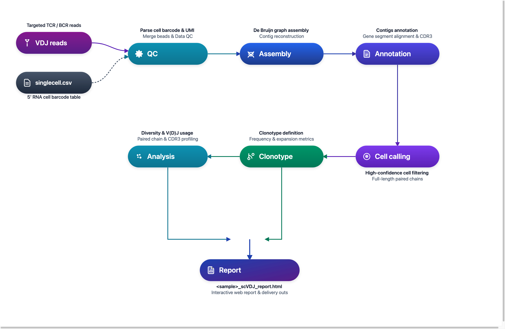

# DNBelab C Series HT scVDJ Analysis Pipeline

Single-Cell VDJ Sequencing Data Analysis Guide

## Overview <a id="overview"></a>

This document provides a detailed guide for analyzing single-cell VDJ sequencing data using dnbc4tools.

**Workflow**: 5' Transcriptome Analysis → VDJ Library Processing → Sequence Assembly & Annotation → Cell Filtering → Clonotype Analysis → Analysis Report

  

 <strong>Usage Note</strong>: <code>$dnbc4tools</code> represents the executable path and must be replaced with the actual installation path. The backslash `\` is used to split a command across multiple lines for readability.

## File Preparation <a id="file-preparation"></a>

### 5' Transcriptome Analysis

For transcriptome analysis, please refer to `dnbc4tools rna run`. The 5' transcriptome analysis pipeline requires adding the `--end5` parameter to the standard single-cell RNA analysis workflow.

Here is an example script to generate an expression matrix for a single sample:

```shell
$dnbc4tools rna run \
	--name sample_5rna \
	--cDNAfastq1 /data/sample_cDNA_R1.fastq.gz \
	--cDNAfastq2 /data/sample_cDNA_R2.fastq.gz \
	--oligofastq1 /data/sample_oligo1_1.fq.gz,/data/sample_oligo2_1.fq.gz \
	--oligofastq2 /data/sample_oligo1_2.fq.gz,/data/sample_oligo2_2.fq.gz \
	--genomeDir /opt/database/Homo_sapiens \
	--threads 30 \
	--end5
```

 <strong>Note</strong>: 5' transcriptome analysis is a prerequisite for VDJ analysis and must be completed first.

### Required Files for VDJ Analysis

The analysis requires the following files:

<table>
  <thead>
    <tr>
      <th>File Type</th>
      <th>Description</th>
    </tr>
  </thead>
  <tbody>
    <tr>
      <td><b>FASTQ Files</b></td>
      <td>VDJ library sequencing data containing TCR or BCR sequence information.</td>
    </tr>
    <tr>
      <td><b>singlecell.csv File</b></td>
      <td>The cell information file from the 5' transcriptome analysis results.</td>
    </tr>
  </tbody>
</table>

The analysis requires the `singlecell.csv` file from the 5' transcriptome analysis output directory. This file contains merged information from the `cell` and `barcode` columns, as well as an `is_cell_barcode` column (1 for a cell, 0 for a non-cell), which is used to identify valid cells.

 <strong>Note</strong>: Ensure the path to the <code>singlecell.csv</code> file is correct, as this file is crucial for linking the transcriptome and VDJ analyses.

Example file content:

```csv
cell,reads,gene,umi,is_cell_barcode,barcode
CELL1118_N3,1485813,5693,57580,1,AGATCGCCTACGATCACGAT;GGTGGAAGGTGAGAGAAGCG;GTAGTTCTAGGCTAAGTACT
CELL1651_N3,805447,4881,32131,1,ATCTCAAGCCCACCGTGTGT;CATCAATTAAGTGATCGCAT;CCTAACTGAGGAACGCTTAG
CELL4_N3,820269,5649,30326,1,AACACCTGATCGTTCAATAA;AATTCGAAGGTAGTCGGAAT;CACATGTTACATGTTCTATA
CELL906_N3,656624,4853,28142,1,ACGTCCGCGTGACCATGTGC;AGGAGCTCCATTGATCTTAA;CAATCCGGAGAACGTATCTG
CELL1577_N2,672637,4610,24822,1,ATATTCTCACGTAACGGATG;TAGGAACTCGGCTTAGATCT
CELL2064_N2,542608,2355,23324,1,CATAAGCACTCACCGCTAGT;GTCTCACAGTTGTTCACTAG
CELL1332_N6,580950,4702,22953,1,AGGTGTAAGCCTACCGGACC;CGCACTCACCTAACATTGTG;CTTGCCGCGCTATCAATGCA;GCCACTAGTCGACGCGGTTG;GTCAGCATGCTCTTCCACAG;TCGATATCCTCACTCTTAAC
CELL726_N4,585934,4617,22660,1,ACCTACGGCGTTACTATGTG;CGACGCTCTCGACAGTTAGG;CGGCAGAGTCTTGGCGCTTA;TCCGACCGTATCTTCATCTC
CELL4010_N1,555308,4268,22554,1,AGAGAGTCGCAGCAAGCGAC
```

## Main Pipeline <a id="main-pipeline"></a>

The main VDJ pipeline combines single-cell VDJ library data with the 5' transcriptome results from the same sample. It includes these key steps:

1.  Filter data and merge beads using the 5' transcriptome results.
2.  Align reads to VDJ gene segments and extract them.
3.  Perform de novo assembly and annotation.
4.  Filter cells based on the assembly annotations and cell calls from the 5' transcriptome.
5.  Integrate results from all steps to generate an HTML report and other output files.

### TCR Analysis

To run TCR analysis for a single sample, two input methods are supported:

**Method 1: Directory (Recommended)**

```shell
$dnbc4tools vdj run \
  --name sample_tcr \
  --fastqs /data/vdjt \
  --ref human \
  --chain TR \
  --beadstrans /sample_5rna/outs/singlecell.csv \
  --threads 10
```

Directory structure example:

```text
/data/vdjt/
├── sample_tcr_R1.fastq.gz
└── sample_tcr_R2.fastq.gz
```

**Method 2: Individual Parameters**

```shell
$dnbc4tools vdj run \
  --name sample_tcr \
  --fastq1 /data/vdjt/sample_tcr_R1.fastq.gz \
  --fastq2 /data/vdjt/sample_tcr_R2.fastq.gz \
  --ref human \
  --chain TR \
  --beadstrans /sample_5rna/outs/singlecell.csv \
  --threads 10
```

### BCR Analysis

To run BCR analysis for a single sample, two input methods are supported:

**Method 1: Directory (Recommended)**

```shell
$dnbc4tools vdj run \
  --name sample_bcr \
  --fastqs /data/vdjb \
  --ref human \
  --chain IG \
  --beadstrans /sample_5rna/outs/singlecell.csv \
  --threads 10
```

Directory structure example:

```text
/data/vdjb/
├── sample_bcr_R1.fastq.gz
└── sample_bcr_R2.fastq.gz
```

**Method 2: Individual Parameters**

```shell
$dnbc4tools vdj run \
  --name sample_bcr \
  --fastq1 /data/vdjb/sample_bcr_R1.fastq.gz \
  --fastq2 /data/vdjb/sample_bcr_R2.fastq.gz \
  --ref human \
  --chain IG \
  --beadstrans /sample_5rna/outs/singlecell.csv \
  --threads 10
```

Input directory requirements:

- The `--fastqs` path should point to the FASTQ directory for the current VDJ library.
- R1/R2 FASTQ pairs should be placed directly under this directory.
- Automatic detection relies on R1/R2 markers in file names. The recommended naming patterns are `_R1`/`_R2` or `_R1_`/`_R2_`.
- TCR and BCR data should be run separately and should not be mixed in the same input directory.

### Execution Process

After auto-detecting the dark reaction, the software begins the analysis. Here is an example:

```shell
──────────────────────────── Parsed FASTQ Inputs — 2025-11-12 15:13:16 ─────────────────────────────
┌───────┬──────────────────────────────────────────────────────────────────────────────────────────┐
│ Type  │ Path                                                                                     │
├───────┼──────────────────────────────────────────────────────────────────────────────────────────┤
│ Read 1 │ /data/vdjt/sample_tcr_R1.fastq.gz                                                        │
│ Read 2 │ /data/vdjt/sample_tcr_R2.fastq.gz                                                        │
└───────┴──────────────────────────────────────────────────────────────────────────────────────────┘
────────────────────────────────────────────────────────────────────────────────────────────────────

──────────────────────────── Chemistry Detection — 2025-11-12 15:13:20 ─────────────────────────────
┌─────────────────────────────────┬────────────────────────────────────────────────────────────────┐
│ Type                            │ Result                                                         │
├─────────────────────────────────┼────────────────────────────────────────────────────────────────┤
│ Read 1                           │ darkreaction                                                   │
└─────────────────────────────────┴────────────────────────────────────────────────────────────────┘
────────────────────────────────────────────────────────────────────────────────────────────────────

 2025-11-12 15:13:20 Starting VDJ library filtering...
...done

 2025-11-12 15:15:46 Preparing input data for VDJ assembly...
...done

 2025-11-12 15:18:14 Performing VDJ sequence assembly and gene segment annotation...
...done

 2025-11-12 16:03:18 Performing cell calling for VDJ data...
...done

 2025-11-12 16:04:02 Generating VDJ clonotype analysis...
...done

 2025-11-12 16:05:02 Converting VDJ results from cellbarcode to cell ID...
...done

 2025-11-12 16:05:15 Generating analysis report and summary statistics...
...done

 2025-11-12 16:05:44 Analysis Finished. Elapsed Time: 0:52:24
```

A successful run will end with `Analysis Finished`.

## Results Interpretation <a id="results-interpretation"></a>

Upon completion, `outs` (outputs) and `logs` directories will be generated. The `outs` directory includes:

```
.
├── airr_annotations.tsv
├── all_contig_annotations.csv
├── all_contig.fasta
├── all_contig.fasta.fai
├── *_scVDJ_IG_report.html
├── clonotypes.csv
├── consensus_annotations.csv
├── consensus.fasta
├── consensus.fasta.fai
├── filtered_contig_annotations.csv
├── filtered_contig.fasta
├── filtered_contig.fasta.fai
└── metrics_summary.xls
```

## Related Documentation

| Resource | Description |
| :--- | :--- |
| [Output File Usage](../io.en.md) | Understanding output file structure and formats |
| [Analysis Parameters](../parameter/scVDJ.en.md) | Complete parameter reference and descriptions |
| [Output Descriptions](../outs/scVDJ.en.md) | Detailed interpretation of analysis results |

## Frequently Asked Questions

This section will be expanded as common usage questions are collected. For the current version, use the run log, parameter reference, and output file documentation as the primary troubleshooting references.
